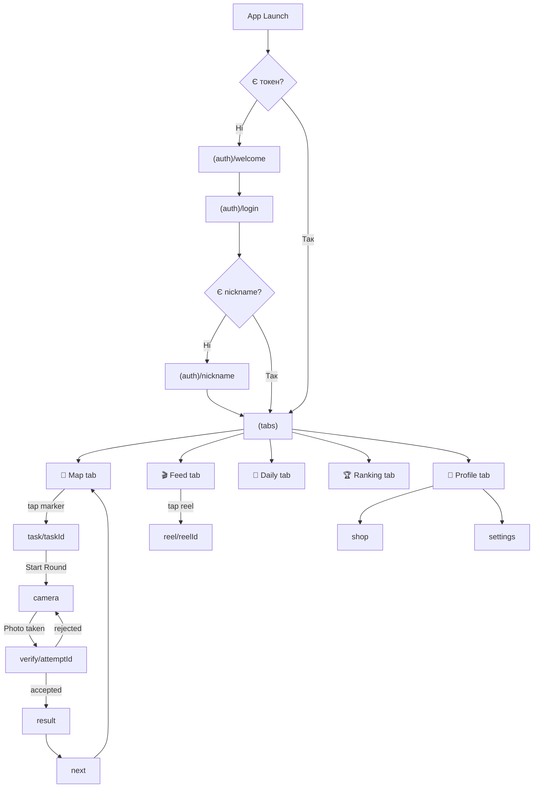
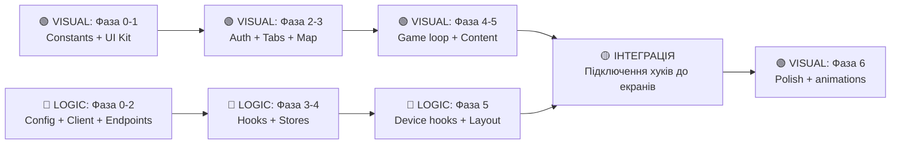

# 📱 Sight Hunter Mobile — Структура та Розподіл Обов'язків

> **Два человека** працюють паралельно на mobile: **AI-VISUAL** 🟢 (UI/екрани/стилі) та **AI-LOGIC** 🔵 (стан/API/хуки/бізнес-логіка).
> Бекенд і ML — інші люди/AI, не чіпаємо. API контракт зафіксований в [`openapi.yaml`]

---

## 📂 Цільова структура `mobile/src/`

```
mobile/src/
├── api/                          # 🔵 AI-LOGIC
│   ├── schema.d.ts               # ✅ Вже є (згенерований з openapi.yaml)
│   ├── client.ts                 # HTTP клієнт (fetch) з JWT interceptor
│   ├── endpoints/                # Функції для кожної групи ендпоінтів
│   │   ├── auth.ts               # register, login, refresh, passwordReset
│   │   ├── me.ts                 # getMe, setNickname
│   │   ├── places.ts             # getNearbyPlaces
│   │   ├── tasks.ts              # getTask, startRound, getShareLink
│   │   ├── rounds.ts             # useHint, createAttempt
│   │   ├── attempts.ts           # submitAttempt, getAttempt (polling)
│   │   ├── reels.ts              # getReelFeed, countReelView, like/unlike, comments
│   │   ├── dailyGame.ts          # getDailyGame, startDailyGame, submitDailyAnswers
│   │   ├── leaderboard.ts        # getLeaderboard
│   │   └── shop.ts               # listShopItems, purchase
│   └── hooks/                    # React Query хуки (обгортки над endpoints)
│       ├── useAuth.ts            # useMutation: login, register, refresh
│       ├── useMe.ts              # useQuery: getMe; useMutation: setNickname
│       ├── usePlaces.ts          # useQuery: getNearbyPlaces(lat, lng, radius)
│       ├── useTask.ts            # useQuery: getTask; useMutation: startRound
│       ├── useRound.ts           # useMutation: useHint, createAttempt
│       ├── useAttempt.ts         # useMutation: submitAttempt; useQuery: pollAttempt
│       ├── useReels.ts           # useInfiniteQuery: feed; useMutation: view, like, comment
│       ├── useDailyGame.ts       # useQuery: getDailyGame; useMutation: start, submitAnswers
│       ├── useLeaderboard.ts     # useQuery: getLeaderboard(scope)
│       └── useShop.ts            # useQuery: listShopItems; useMutation: purchase
│
├── store/                        # 🔵 AI-LOGIC — Zustand stores
│   ├── authStore.ts              # tokens, user, isAuthenticated, login/logout actions
│   ├── gameStore.ts              # activeRound, activeAttempt, hintsUsed, demoMode
│   ├── locationStore.ts          # currentPosition, watchId, mockPosition (demo)
│   └── settingsStore.ts          # language, ttsEnabled, cameraPermission, locationPermission
│
├── hooks/                        # 🔵 AI-LOGIC — Device/platform хуки
│   ├── useLocation.ts            # expo-location watch + demo mode override
│   ├── useCamera.ts              # expo-camera permissions + capture + resize (1280px)
│   ├── usePhotoUpload.ts         # presigned PUT upload до S3/R2
│   ├── useVerificationPolling.ts # poll GET /attempts/{id} кожну секунду до verdict
│   └── useIdempotencyKey.ts      # генерація UUID для Idempotency-Key header
│
├── components/                   # 🟢 AI-VISUAL — Переиспользуємі UI компоненти
│   ├── ui/                       # Atomic Design — атоми/молекули
│   │   ├── Button.tsx            # Primary, secondary, outline, ghost варіанти
│   │   ├── TextInput.tsx         # З label, error, icon
│   │   ├── Card.tsx              # Карточка з тінню, border-radius
│   │   ├── Avatar.tsx            # Аватарка з fallback initials
│   │   ├── Badge.tsx             # XP, Points, статус
│   │   ├── BottomSheet.tsx       # Модалка знизу (gesture handler)
│   │   ├── LoadingSpinner.tsx    # Анімований спінер
│   │   ├── ErrorBanner.tsx       # Банер помилки
│   │   ├── ProgressBar.tsx       # Прогрес-бар (для verification)
│   │   ├── IconButton.tsx        # Кнопка-іконка (like, share, hint)
│   │   └── Chip.tsx              # Теги/фільтри
│   │
│   ├── map/                      # Компоненти карти
│   │   ├── GameMap.tsx           # react-native-maps обгортка
│   │   ├── PlaceMarker.tsx       # Маркер знайденого/незнайденого місця
│   │   └── SearchCircle.tsx      # Коло пошуку (offset зона)
│   │
│   ├── reels/                    # Компоненти рілсів
│   │   ├── ReelPlayer.tsx        # expo-video плеєр (вертикальний, autoplay)
│   │   ├── ReelCard.tsx          # Карточка рілса у фіді
│   │   ├── ReelOverlay.tsx       # Overlay з like/comment/share кнопками
│   │   ├── CommentSheet.tsx      # Лист коментарів (BottomSheet)
│   │   └── ShareSheet.tsx        # Шерінг завдання
│   │
│   ├── game/                     # Компоненти ігрового циклу
│   │   ├── RiddleCard.tsx        # Картка із загадкою + архівне фото
│   │   ├── HintDialog.tsx        # Діалог підказки (до 3-х)
│   │   ├── VerifySteps.tsx       # Анімація 2-крокової перевірки (GPS → CLIP)
│   │   ├── ResultBadge.tsx       # Бейдж результату (accepted/rejected)
│   │   ├── RewardAnimation.tsx   # Анімація нарахування очків/XP
│   │   └── NextPlacePicker.tsx   # Вибір наступного місця (3 варіанти)
│   │
│   ├── daily/                    # Компоненти міні-гри
│   │   ├── QuizCard.tsx          # Картка питання з фото + 4 варіанти
│   │   └── QuizResult.tsx        # Результат вікторини
│   │
│   ├── shop/                     # Компоненти магазину
│   │   ├── ShopItemCard.tsx      # Картка товару
│   │   └── PurchaseDialog.tsx    # Підтвердження покупки
│   │
│   └── layout/                   # Структурні компоненти
│       ├── ScreenWrapper.tsx     # SafeArea + StatusBar + padding
│       ├── Header.tsx            # Заголовок екрану з back/action
│       └── TabBarIcon.tsx        # Іконка табу з badge
│
├── constants/                    # 🟡 СПІЛЬНЕ — AI-VISUAL створює, AI-LOGIC використовує
│   ├── theme.ts                  # Об'єднаний об'єкт теми
│   ├── colors.ts                 # Палітра кольорів (primary: #208AEF, тощо)
│   ├── typography.ts             # Шрифти, розміри, ваги
│   ├── spacing.ts                # Відступи (4, 8, 12, 16, 20, 24, 32)
│   └── config.ts                 # API_BASE_URL, timeouts, limits
│
├── types/                        # 🔵 AI-LOGIC
│   ├── navigation.ts             # Типи для навігаційних параметрів
│   └── index.ts                  # Re-export всіх типів + допоміжні
│
├── utils/                        # 🔵 AI-LOGIC
│   ├── formatters.ts             # formatPoints, formatXP, formatDate, formatDistance
│   ├── geo.ts                    # haversine distance, isWithinRadius
│   ├── idempotency.ts            # generateIdempotencyKey (uuid)
│   ├── storage.ts                # expo-secure-store обгортки для tokens
│   └── validators.ts             # email, password, nickname validation
│
└── app/                          # Екрани (routes)
    ├── _layout.tsx               # 🔵 Root: QueryClientProvider + Zustand + Auth guard
    │
    ├── (auth)/                   # Група авторизації (без табів)
    │   ├── _layout.tsx           # 🟢 Stack layout
    │   ├── welcome.tsx           # 🟢 Welcome screen
    │   ├── login.tsx             # 🟢 Логін/Реєстрація
    │   └── nickname.tsx          # 🟢 Встановлення нікнейму
    │
    ├── (tabs)/                   # Головний навігатор з табами
    │   ├── _layout.tsx           # 🟢 Tab bar
    │   ├── index.tsx             # 🟢 Карта (home tab)
    │   ├── feed.tsx              # 🟢 Фід рілсів
    │   ├── daily.tsx             # 🟢 Щоденна міні-гра
    │   ├── ranking.tsx           # 🟢 Лідерборд
    │   └── profile.tsx           # 🟢 Профіль гравця
    │
    ├── task/
    │   └── [taskId].tsx          # 🟢 Деталі завдання
    ├── camera.tsx                # 🟢 Екран камери
    ├── verify/
    │   └── [attemptId].tsx       # 🟢 Верифікація + polling
    ├── result.tsx                # 🟢 Результат раунду
    ├── next.tsx                  # 🟢 Вибір наступного місця
    ├── shop.tsx                  # 🟢 Магазин
    ├── settings.tsx              # 🟢 Налаштування
    ├── reel/
    │   └── [reelId].tsx          # 🟢 Повноекранний рілс-плеєр
    └── onboarding.tsx            # 🟢 Онбордінг
```

---

## 🗺️ Карта екранів та навігації



---

## 🟢 ПОВНИЙ ПЛАН ДЛЯ AI-VISUAL (UI / Верстка / Анімації)

> **Роль:** Створити ВСІ візуальні компоненти та екрани. Використовувати mock-дані (hardcoded) для відображення.
> Кожен компонент приймає дані через props — не робити API запити, не працювати з Zustand напряму.

---

### Фаза 0 — Фундамент дизайну

> **Створити файли `src/constants/`** — кольори, типографіка, відступи. Це база для всього UI.

#### Файл: `src/constants/colors.ts`
```typescript
export const Colors = {
  primary: '#208AEF',        // Головний синій (зі splash screen)
  primaryDark: '#1A6FBF',
  primaryLight: '#E6F4FE',
  secondary: '#FF6B35',      // Акцентний помаранчевий
  success: '#22C55E',        // Accepted
  error: '#EF4444',          // Rejected / Error
  warning: '#F59E0B',        // Hint penalty
  background: '#FFFFFF',
  surface: '#F8FAFC',
  surfaceElevated: '#FFFFFF',
  text: '#0F172A',
  textSecondary: '#64748B',
  textTertiary: '#94A3B8',
  border: '#E2E8F0',
  overlay: 'rgba(0,0,0,0.5)',
  // Map
  markerFound: '#22C55E',
  markerUnfound: '#208AEF',
  searchCircle: 'rgba(32,138,239,0.15)',
  searchCircleBorder: 'rgba(32,138,239,0.4)',
} as const;
```

#### Файл: `src/constants/typography.ts`
```typescript
export const Typography = {
  h1: { fontSize: 28, fontWeight: '700' as const, lineHeight: 34 },
  h2: { fontSize: 22, fontWeight: '700' as const, lineHeight: 28 },
  h3: { fontSize: 18, fontWeight: '600' as const, lineHeight: 24 },
  body: { fontSize: 16, fontWeight: '400' as const, lineHeight: 22 },
  bodyBold: { fontSize: 16, fontWeight: '600' as const, lineHeight: 22 },
  caption: { fontSize: 13, fontWeight: '400' as const, lineHeight: 18 },
  captionBold: { fontSize: 13, fontWeight: '600' as const, lineHeight: 18 },
  button: { fontSize: 16, fontWeight: '600' as const, lineHeight: 20 },
  tabLabel: { fontSize: 10, fontWeight: '500' as const, lineHeight: 14 },
} as const;
```

#### Файл: `src/constants/spacing.ts`
```typescript
export const Spacing = {
  xs: 4, sm: 8, md: 12, lg: 16, xl: 20, xxl: 24, xxxl: 32,
} as const;

export const BorderRadius = {
  sm: 8, md: 12, lg: 16, xl: 24, full: 9999,
} as const;
```

---

### Фаза 1 — UI Kit (атомарні компоненти)

> Створити `src/components/ui/` — 11 базових компонентів. Кожен повністю самодостатній, з `StyleSheet`.

| # | Компонент | Props інтерфейс | Деталі реалізації |
|---|-----------|-----------------|-------------------|
| 1 | `Button.tsx` | `title: string, onPress: () => void, variant?: 'primary'\|'secondary'\|'outline'\|'ghost', size?: 'sm'\|'md'\|'lg', loading?: boolean, disabled?: boolean, icon?: ReactNode` | Reanimated scale animation при натисканні. `loading` → показує `ActivityIndicator` замість title |
| 2 | `TextInput.tsx` | `label: string, value: string, onChangeText: (t: string) => void, placeholder?: string, error?: string, secureTextEntry?: boolean, icon?: ReactNode, keyboardType?: KeyboardTypeOptions` | Floating label animation. Бордер червоний при `error`. Eye icon toggle для паролю |
| 3 | `Card.tsx` | `children: ReactNode, padding?: number, elevation?: 'sm'\|'md'\|'lg', style?: ViewStyle` | Shadow + border-radius. 3 рівні тіні |
| 4 | `Avatar.tsx` | `uri?: string \| null, nickname?: string, size?: 'sm'(32)\|'md'(48)\|'lg'(80)` | expo-image з fallback: перші 2 літери nickname на кольоровому фоні |
| 5 | `Badge.tsx` | `value: number \| string, type: 'xp'\|'points'\|'status', size?: 'sm'\|'md'` | Іконка ⭐(xp)/💎(points) + formatted value. Кольори по type |
| 6 | `BottomSheet.tsx` | `visible: boolean, onClose: () => void, snapPoints?: number[], children: ReactNode, title?: string` | `react-native-gesture-handler` + `reanimated`. Drag to close. Overlay backdrop |
| 7 | `LoadingSpinner.tsx` | `size?: number, color?: string` | Reanimated rotating circle animation |
| 8 | `ErrorBanner.tsx` | `message: string, onRetry?: () => void, onDismiss?: () => void` | Червоний банер зверху. Кнопка «Spróbuj ponownie» якщо `onRetry` |
| 9 | `ProgressBar.tsx` | `progress: number (0-1), color?: string, animated?: boolean, height?: number` | Reanimated ширина анімація. `animated=true` → плавне зростання |
| 10 | `IconButton.tsx` | `icon: ReactNode, onPress: () => void, size?: number, badge?: number, color?: string` | Кругла кнопка з іконкою. Badge в правому верхньому куті |
| 11 | `Chip.tsx` | `label: string, selected?: boolean, onPress?: () => void` | Pill shape. selected → primary fill, unselected → outline |

---

### Фаза 2 — Екрани авторизації

#### `src/app/(auth)/_layout.tsx`
- Stack navigator без header (headerShown: false)
- Фон: `Colors.background`

#### `src/app/(auth)/welcome.tsx`
- **Layout:** Повноекранний, flex column, center
- Фон: gradient або `Colors.primaryLight`
- `expo-image` логотип (`assets/images/logo-glow.png`) з glow effect
- Заголовок «Łowcy Historii» (Typography.h1)
- Підзаголовок «Odkryj historię Wrocławia» (Typography.body, textSecondary)
- Пробіл
- `Button variant="primary"` → «Zarejestruj się» → navigate to `login?mode=register`
- `Button variant="outline"` → «Zaloguj się» → navigate to `login?mode=login`
- Reanimated: fade-in + slide-up при mount

#### `src/app/(auth)/login.tsx`
- **Параметр:** `mode: 'login' | 'register'` (з URL param)
- Toggle зверху: два Chip'и «Logowanie» / «Rejestracja»
- **Register mode:**
  - `TextInput label="E-mail" keyboardType="email-address"`
  - `TextInput label="Hasło" secureTextEntry` (мін 8 символів, 1 літера, 1 цифра)
  - `TextInput label="Kod polecenia" placeholder="Opcjonalnie"`
  - `Button "Zarejestruj się"`
- **Login mode:**
  - `TextInput label="E-mail"`
  - `TextInput label="Hasło" secureTextEntry`
  - `Button "Zaloguj się"`
  - Link text «Zapomniałeś hasła?» (caption, primary color)
- `ErrorBanner` зверху при помилці (передається через prop `error?: string`)
- Props-driven: `onSubmit: (data) => void`, `error?: string`, `loading?: boolean`

#### `src/app/(auth)/nickname.tsx`
- Великий заголовок «Jak masz na imię, łowco?» (h1)
- Підзаголовок «Wybierz pseudonim, który zobaczą inni gracze» (body, textSecondary)
- `TextInput label="Pseudonim"` з лічильником символів (3-24)
- `Button "Dalej" disabled={nickname.length < 3}`
- Props: `onSubmit: (nickname: string) => void, error?: string, loading?: boolean`

---

### Фаза 3 — Таби та карта

#### `src/app/(tabs)/_layout.tsx`
- Bottom tab bar з 5 табами
- Конфігурація:

| Tab | Label | Icon | Route |
|-----|-------|------|-------|
| 📍 | Mapa | `map-pin` | `index` |
| 🎬 | Odkrycia | `film` | `feed` |
| 🧠 | Quiz | `brain` | `daily` |
| 🏆 | Ranking | `trophy` | `ranking` |
| 👤 | Profil | `user` | `profile` |

- `TabBarIcon.tsx` з badge (число) для quiz tab
- Active: `Colors.primary`, inactive: `Colors.textTertiary`

#### `src/app/(tabs)/index.tsx` — Карта (головний екран)
- Повноекранна `GameMap.tsx`:

**`src/components/map/GameMap.tsx`:**
- Props:
```typescript
{
  places: PlaceMarker[];
  userPosition: { lat: number; lng: number } | null;
  onMarkerPress: (taskId: string) => void;
  onLongPress?: (coords: { lat: number; lng: number }) => void;
  demoMode?: boolean;
}
```
- MapView (react-native-maps) з initialRegion Wrocław: `{lat: 51.1079, lng: 17.0385, latDelta: 0.02, lngDelta: 0.02}`
- Рендер `PlaceMarker` для кожного place
- Рендер `SearchCircle` для кожного unfound place
- User position blue dot

**`src/components/map/PlaceMarker.tsx`:**
- Props: `place: PlaceMarker, onPress: () => void`
- `found=true`: зелений pin + назва зверху
- `found=false`: синій пульсуючий pin (Reanimated loop: scale 1→1.3→1, opacity 1→0.6→1)

**`src/components/map/SearchCircle.tsx`:**
- Props: `center: { lat: number; lng: number }, radius_m: number`
- Circle overlay з `Colors.searchCircle` fill, `Colors.searchCircleBorder` stroke

- FAB знизу-справа: «📍» → центрувати карту на user position
- В demo mode: банер зверху «Tryb demo — dotknij i przytrzymaj mapę»

#### `src/app/task/[taskId].tsx` — Деталі завдання
- Header з кнопкою back
- **`RiddleCard.tsx`** (Props: `task: Task`):
  - Архівне фото (expo-image, якщо `archival_photo_url !== null`) з rounded corners
  - Текст загадки (Typography.h3): `task.riddle`
  - Row з badges: `reward_points` (💎) + `reward_xp` (⭐)
- Секція підказок: до 3 кнопок «Wskazówka {n}» (outline), використані — показують текст
- **`HintDialog.tsx`** (Props: `visible, hintText, hintsUsed, newRewardPoints, onClose`):
  - BottomSheet
  - Іконка 💡 + «Wskazówka {hintsUsed}/3»
  - Текст підказки
  - Warning: «Nagroda zmniejszona do {newRewardPoints} pkt»
  - Button «Rozumiem» → close
- Велика кнопка «📷 Zrób zdjęcie» → navigate to camera (primary, full width)
- Share button (outline) → getShareLink

---

### Фаза 4 — Ігровий цикл

#### `src/app/camera.tsx`
- Повноекранний expo-camera `CameraView`
- Viewfinder overlay: напівпрозорий чорний з прозорим прямокутником по центру (aspect 3:4)
- Нижня панель (над safe area):
  - Зліва: flip camera button (IconButton)
  - По центру: capture button — велике біле коло (80px) з inner circle (68px), scale animation on press
  - Справа: flash toggle button
- **Після зняття:** показати preview з двома кнопками:
  - «✓ Wyślij» (primary) → trigger verification flow
  - «↻ Powtórz» (outline) → повернутися до камери
- Props для інтеграції: `onPhotoTaken: (uri: string) => void, onCancel: () => void`

#### `src/app/verify/[attemptId].tsx`
- **`src/components/game/VerifySteps.tsx`:**
- Props:
```typescript
{
  status: 'uploading' | 'gps_check' | 'clip_check' | 'accepted' | 'rejected';
  gpsProgress?: number;   // 0-1
  clipProgress?: number;  // 0-1
  reason?: 'wrong_place' | 'not_matched' | null;
  wrongPlaceName?: string | null;
}
```
- **Крок 1 — GPS:**
  - Іконка 📍 (велика, primary)
  - «Sprawdzam lokalizację...» → ProgressBar animated
  - Після завершення: ✅ «Lokalizacja OK» (зелений)
- **Крок 2 — CLIP:**
  - Іконка 📷 (велика, primary)
  - «Porównuję zdjęcie...» → ProgressBar animated
  - Після завершення: ✅ або ❌
- **Результат `accepted`:**
  - Великий зелений ✅ badge
  - «Znaleziono!» (h2, success color)
  - Confetti animation (reanimated particles)
  - Button «Zobacz nagrodę» → navigate to result
- **Результат `rejected`:**
  - Великий червоний ❌ badge
  - Якщо `wrong_place`: «To jest {wrong_place_name}!» + «Szukaj dalej...»
  - Якщо `not_matched`: «Nie rozpoznano — spróbuj ponownie»
  - Button «Spróbuj ponownie» → navigate back to camera
  - Info: «Pozostało prób: {attempts_left}»

#### `src/app/result.tsx`
- Фон: gradient або primary light
- Заголовок «Gratulacje!» (h1)
- **`RewardAnimation.tsx`** (Props: `points: number, xp: number`):
  - Counter animation від 0 → points (reanimated, ~1.5 сек)
  - Counter animation від 0 → xp
  - Badges: 💎 {points} pkt + ⭐ {xp} XP
- Карточка розблокованого рілса (якщо є `reelId`):
  - Thumbnail + title + «Odblokowano!» badge
  - Кнопка «▶ Obejrzyj historię» → navigate to `reel/[reelId]`
- Кнопка «Szukaj dalej» (primary) → navigate to `next`

#### `src/app/next.tsx`
- Заголовок «Co dalej?» (h2)
- **`NextPlacePicker.tsx`** (Props: `options: NextOption[], onSelect: (taskId) => void`):
- 3 карточки (Card component):
  - 🧭 **«Najbliższe»** — назва + відстань (якщо found) або «??? — {distance}»
  - 🔥 **«Najpopularniejsze»** — назва + `{finders_count} łowców`
  - 🎲 **«Losowe w pobliżu»** — «Zaskocz mnie!»
- Кожна карточка: icon (велика, ліворуч) + title + subtitle (праворуч) + chevron
- Тап → navigate to `task/[taskId]`

---

### Фаза 5 — Контентні екрани

#### `src/app/(tabs)/feed.tsx` — Фід рілсів
- Вертикальний FlatList з `pagingEnabled` (snap-to-item)
- **`ReelCard.tsx`** (Props: `reel: Reel, onLike, onComment, onShare, onView`):
  - Повноекранне відео (expo-video VideoView) або blur + 🔒 для locked
  - Overlay gradient знизу (transparent → black 50%)
  - Title (bold, white) + finders count
  - Locked: blur background + lock icon + «Kup za {price_points} pkt» button
- **`ReelOverlay.tsx`** (Props: `reel, onLike, onComment, onShare`):
  - Правий стовпець (absolute right, bottom):
    - ❤️ Like button (heart animation: scale + color red при liked_by_me) + likes_count
    - 💬 Comment button + кількість
    - 🔗 Share button
- **`CommentSheet.tsx`** (Props: `comments: Comment[], onAdd: (text) => void, visible, onClose`):
  - BottomSheet 60% висоти
  - FlatList коментарів: avatar + nickname + text + date
  - Input знизу + Send button
- **`ShareSheet.tsx`** (Props: `url: string, visible, onClose`):
  - BottomSheet з URL + Copy button + native share

#### `src/app/(tabs)/daily.tsx` — Щоденна вікторина
- Заголовок «Quiz dnia» + formatted date
- **`QuizCard.tsx`** (Props: `question: {id, text, image_url?, options}, selectedIndex?, onSelect`):
  - Image (якщо є) — зверху, rounded, 200px висота
  - Текст питання (h3)
  - 4 варіанти — кнопки (outline, selected → primary fill)
- Horizontal pager (або FlatList з pagination dots)
- Кнопка «Sprawdź odpowiedzi» (після вибору всіх 5)
- **`QuizResult.tsx`** (Props: `score: number, total: number, pointsAwarded: number, correct: {questionId, optionIndex}[]`):
  - Великий score «{score}/{total}»
  - Badge «+{pointsAwarded} pkt»
  - Список: правильні (зелений ✅) / неправильні (червоний ❌)

#### `src/app/(tabs)/ranking.tsx` — Лідерборд
- Toggle row: `Chip "Tydzień"` (selected) + `Chip "Wszyscy"`
- Топ-3 подіум (кастомний layout):
  - Центр: 1 місце (великий Avatar + gold crown + nickname + xp)
  - Ліворуч: 2 місце (менший, silver)
  - Праворуч: 3 місце (менший, bronze)
- FlatList для 4-50: `rank | Avatar(sm) | nickname | xp XP`
- Highlighted row для `me` (primary background light)

#### `src/app/(tabs)/profile.tsx`
- Header: Avatar(lg) + nickname (h2) + email (caption)
- Stats row (3 Cards в ряд):
  - 💎 `{points}` pts | ⭐ `{xp}` XP | 📍 `{found_count}` Znalezione
- Section «Kod polecenia»: Card з ref_code + Copy button
- Section «Moje odkrycia»: Grid (3 cols) з thumbnails розблокованих рілсів
- Buttons: «🛒 Sklep» → shop, «⚙️ Ustawienia» → settings

#### `src/app/shop.tsx`
- Баланс зверху: Card з «💎 {balance} pkt» (великий h2)
- Section «Wskazówki» (type='hint'):
  - **`ShopItemCard.tsx`** (Props: `item: ShopItem, onBuy: () => void, canAfford: boolean`):
    - Name + description + quantity (якщо є)
    - Price badge (primary)
    - Buy button (disabled якщо !canAfford)
- Section «Odkrycia» (type='reel')
- Section «Partnerzy» (type='partner')
- **`PurchaseDialog.tsx`** (Props: `item: ShopItem, visible, onConfirm, onCancel, result?`):
  - «Kupić {name} za {price_points} pkt?»
  - Two buttons: «Kup» (primary) + «Anuluj» (ghost)
  - After purchase: success message + coupon_code (якщо partner)

#### `src/app/settings.tsx`
- SectionList layout
- **Konto:** email (read-only), nickname
- **Uprawnienia:** Camera status (granted/denied + «Zmień»), Location status
- **Gra:** Toggle «TTS» (text-to-speech), Toggle «Tryb demo»
- **O aplikacji:** «Łowcy Historii v1.0.0», «BEST Hacks 2026»
- Button «Wyloguj się» (error color, bottom)

#### `src/app/onboarding.tsx`
- Horizontal pager, 2-3 slides:
  1. Іконка 🏛 + «Witaj w grze!» + «Szukaj historycznych miejsc we Wrocławiu, rób zdjęcia i odkrywaj ich historię»
  2. Іконка 🎁 + «Twój pierwszy bonus!» + «Otrzymujesz 50 punktów i 1 darmową wskazówkę na start»
- Dots indicator
- Button «Zacznij grę» (на останньому slide)

---

### Фаза 6 — Полірування

| Що | Де | Як |
|----|----|----|
| Skeleton loaders | feed, ranking, shop, profile | Gray animated rectangles замість контенту під час loading |
| Pull-to-refresh | feed, ranking, daily, shop | `RefreshControl` на FlatList/ScrollView |
| Empty states | feed, ranking, comments | Іконка + текст «Nic tu jeszcze nie ma» |
| Screen transitions | task → camera → verify → result | Shared element transition для фото (Reanimated) |
| Haptic feedback | buttons, like, camera capture | `expo-haptics` (якщо встановлене) |
| Keyboard avoiding | login, nickname, comment input | `KeyboardAvoidingView` з behavior="padding" |

---

## 🔵 ПОВНИЙ ПЛАН ДЛЯ AI-LOGIC (Стан / API / Хуки / Бізнес-логіка)

> **Роль:** Створити ВСЮ логіку додатку. Компоненти не верстати — це робить AI-VISUAL.
> Кожен хук / store повертає дані та функції, які AI-VISUAL підключить через props.
> Типи беруться з [`schema.d.ts`](file:///Users/danilo/repo/sight-hunter/mobile/src/api/schema.d.ts) (вже згенерований з openapi.yaml).

---

### Фаза 0 — Інфраструктура та утиліти

#### Файл: `src/constants/config.ts`
```typescript
export const Config = {
  API_BASE_URL: __DEV__
    ? 'http://localhost:8000/api/v1'
    : 'https://api.sight-hunter.com/api/v1',
  ATTEMPT_POLL_INTERVAL_MS: 1000,
  ATTEMPT_POLL_MAX_RETRIES: 20,     // ~20 секунд
  MAX_HINTS_PER_ROUND: 3,
  PHOTO_MAX_WIDTH: 1280,
  NEARBY_REFETCH_INTERVAL_MS: 30000, // Оновлювати маркери кожні 30 сек
  TOKEN_REFRESH_THRESHOLD_MS: 2 * 60 * 1000,
} as const;
```

#### Файл: `src/utils/storage.ts`
```typescript
import * as SecureStore from 'expo-secure-store';

const KEYS = { ACCESS: 'access_token', REFRESH: 'refresh_token' } as const;

export async function setTokens(access: string, refresh: string): Promise<void>;
export async function getAccessToken(): Promise<string | null>;
export async function getRefreshToken(): Promise<string | null>;
export async function clearTokens(): Promise<void>;
```

#### Файл: `src/utils/idempotency.ts`
```typescript
// Використати crypto.randomUUID() (доступний в React Native 0.86+)
export function generateIdempotencyKey(): string {
  return crypto.randomUUID();
}
```

#### Файл: `src/utils/validators.ts`
```typescript
/** Повертає текст помилки польською або null якщо OK */
export function validateEmail(email: string): string | null;
// Перевіряє format: string@string.string

export function validatePassword(pw: string): string | null;
// Мін 8 символів, мін 1 літера, мін 1 цифра
// Помилка: "Hasło musi mieć min. 8 znaków, literę i cyfrę"

export function validateNickname(nick: string): string | null;
// 3-24 символи
// Помилка: "Pseudonim musi mieć 3-24 znaki"
```

#### Файл: `src/utils/formatters.ts`
```typescript
export function formatPoints(n: number): string;    // "1 234 pkt"
export function formatXP(n: number): string;         // "1 234 XP"
export function formatDistance(meters: number): string;  // "1.2 km" або "350 m"
export function formatDate(iso: string): string;     // "10 paź 2026"
export function formatDuration(seconds: number): string; // "0:35"
```

#### Файл: `src/utils/geo.ts`
```typescript
/** Haversine formula, повертає метри */
export function haversineDistance(
  lat1: number, lng1: number,
  lat2: number, lng2: number
): number;

export function isWithinRadius(
  point: { lat: number; lng: number },
  center: { lat: number; lng: number },
  radiusM: number
): boolean;
```

---

### Фаза 1 — API Client з JWT Refresh

#### Файл: `src/api/client.ts`

**Повна специфікація:**

```typescript
import { components } from './schema';

type ApiError = components['schemas']['Error'];

class ApiClientError extends Error {
  code: string;
  details?: Record<string, unknown>;
  status: number;

  constructor(status: number, error: ApiError) {
    super(error.message);
    this.code = error.code;
    this.details = error.details;
    this.status = status;
  }
}

interface RequestOptions {
  body?: unknown;
  params?: Record<string, string | number>;
  headers?: Record<string, string>;
  noAuth?: boolean;
}

async function apiClient<T>(
  method: 'GET' | 'POST' | 'PUT' | 'DELETE',
  path: string,
  options?: RequestOptions,
): Promise<T>;
```

**Логіка всередині:**

1. Побудувати URL: `Config.API_BASE_URL + path + ?queryParams`
2. Якщо `!options?.noAuth`:
   - Отримати access token з `authStore.getState().accessToken`
   - Додати header `Authorization: Bearer ${token}`
3. Відправити fetch з `method`, `headers`, `body: JSON.stringify()`
4. Якщо response.status === 401 і path !== '/auth/refresh':
   - Спробувати refresh: `POST /auth/refresh` з refresh token
   - Якщо refresh OK → зберегти нові токени → повторити оригінальний запит
   - Якщо refresh 401 → `authStore.getState().logout()` → throw
5. Якщо response.ok → parse JSON, return
6. Якщо !response.ok → parse error body → throw `ApiClientError`
7. Для 204 → return undefined as T

---

### Фаза 2 — Типізовані Endpoint функції

#### `src/api/endpoints/auth.ts`
```typescript
import { components } from '../schema';
import { apiClient } from '../client';

type AuthResponse = {
  access: string;
  refresh: string;
  user: components['schemas']['User'];
};

export async function register(data: components['schemas']['RegisterRequest']): Promise<AuthResponse> {
  return apiClient('POST', '/auth/register', { body: data, noAuth: true });
}

export async function login(data: components['schemas']['LoginRequest']): Promise<AuthResponse> {
  return apiClient('POST', '/auth/login', { body: data, noAuth: true });
}

export async function refreshTokens(refresh: string): Promise<AuthResponse> {
  return apiClient('POST', '/auth/refresh', { body: { refresh }, noAuth: true });
}

export async function requestPasswordReset(email: string): Promise<void> {
  return apiClient('POST', '/auth/password-reset', { body: { email }, noAuth: true });
}
```

#### `src/api/endpoints/me.ts`
```typescript
export async function getMe(): Promise<User>;
export async function setNickname(nickname: string): Promise<User>;
```

#### `src/api/endpoints/places.ts`
```typescript
export async function getNearbyPlaces(
  lat: number, lng: number, radius?: number
): Promise<{ items: PlaceMarker[] }>;
// GET /places/nearby?lat=...&lng=...&radius=...
```

#### `src/api/endpoints/tasks.ts`
```typescript
export async function getTask(taskId: string): Promise<Task>;
// GET /tasks/{taskId}

export async function startRound(taskId: string): Promise<Round>;
// POST /tasks/{taskId}/rounds

export async function getShareLink(taskId: string): Promise<{ url: string }>;
// GET /tasks/{taskId}/share-link
```

#### `src/api/endpoints/rounds.ts`
```typescript
export async function useHintEndpoint(
  roundId: string, idempotencyKey: string
): Promise<{ hint_text: string; hints_used: number; reward_points: number }>;
// POST /rounds/{roundId}/hints + Idempotency-Key header

export async function createAttempt(
  roundId: string, data: AttemptRequest
): Promise<{ attempt_id: string; upload_url: string; upload_expires_at: string }>;
// POST /rounds/{roundId}/attempts
```

#### `src/api/endpoints/attempts.ts`
```typescript
export async function submitAttempt(
  attemptId: string, idempotencyKey: string
): Promise<Attempt>;
// POST /attempts/{attemptId}/submit + Idempotency-Key header

export async function getAttempt(attemptId: string): Promise<Attempt>;
// GET /attempts/{attemptId}
```

#### `src/api/endpoints/reels.ts`
```typescript
export async function getReelFeed(cursor?: string): Promise<{ items: Reel[]; next_cursor: string | null }>;
export async function countReelView(reelId: string): Promise<void>;
export async function likeReel(reelId: string): Promise<void>;
export async function unlikeReel(reelId: string): Promise<void>;
export async function listComments(reelId: string, cursor?: string): Promise<{ items: Comment[]; next_cursor: string | null }>;
export async function addComment(reelId: string, text: string): Promise<Comment>;
```

#### `src/api/endpoints/dailyGame.ts`
```typescript
export async function getDailyGame(): Promise<DailyGame>;
export async function startDailyGame(): Promise<{ started_at: string }>;
export async function submitDailyAnswers(
  answers: { question_id: string; option_index: number }[]
): Promise<DailyGameResult>;
```

#### `src/api/endpoints/leaderboard.ts`
```typescript
export async function getLeaderboard(
  scope?: 'week' | 'all'
): Promise<{ items: LeaderboardEntry[]; me: LeaderboardEntry }>;
```

#### `src/api/endpoints/shop.ts`
```typescript
export async function listShopItems(): Promise<{ balance: number; items: ShopItem[] }>;
export async function purchase(
  itemId: string, idempotencyKey: string
): Promise<{ balance: number; item: ShopItem; coupon_code?: string | null }>;
```

---

### Фаза 3 — React Query Hooks

> Файли в `src/api/hooks/`. Кожен хук використовує endpoint функції + query keys.

#### Query Keys Convention
```typescript
// src/api/hooks/queryKeys.ts
export const queryKeys = {
  me: ['me'] as const,
  nearbyPlaces: (lat: number, lng: number) => ['places', 'nearby', lat, lng] as const,
  task: (id: string) => ['task', id] as const,
  attempt: (id: string) => ['attempt', id] as const,
  reelFeed: ['reels', 'feed'] as const,
  comments: (reelId: string) => ['reels', reelId, 'comments'] as const,
  dailyGame: ['daily-game'] as const,
  leaderboard: (scope: string) => ['leaderboard', scope] as const,
  shopItems: ['shop', 'items'] as const,
} as const;
```

#### `src/api/hooks/useAuth.ts`
```typescript
export function useLogin() {
  const setTokens = useAuthStore(s => s.setTokens);
  const setUser = useAuthStore(s => s.setUser);

  return useMutation({
    mutationFn: (data: LoginRequest) => login(data),
    onSuccess: ({ access, refresh, user }) => {
      setTokens(access, refresh);
      setUser(user);
    },
  });
}

export function useRegister() {
  // Аналогічно login, але з register endpoint
}

export function usePasswordReset() {
  return useMutation({
    mutationFn: (email: string) => requestPasswordReset(email),
  });
}
```

#### `src/api/hooks/useMe.ts`
```typescript
export function useMe() {
  const isAuthenticated = useAuthStore(s => s.isAuthenticated);
  return useQuery({
    queryKey: queryKeys.me,
    queryFn: getMe,
    enabled: isAuthenticated,
  });
}

export function useSetNickname() {
  const queryClient = useQueryClient();
  const setUser = useAuthStore(s => s.setUser);

  return useMutation({
    mutationFn: (nickname: string) => setNickname(nickname),
    onSuccess: (user) => {
      setUser(user);
      queryClient.invalidateQueries({ queryKey: queryKeys.me });
    },
  });
}
```

#### `src/api/hooks/usePlaces.ts`
```typescript
export function useNearbyPlaces(lat: number, lng: number, radius?: number) {
  return useQuery({
    queryKey: queryKeys.nearbyPlaces(lat, lng),
    queryFn: () => getNearbyPlaces(lat, lng, radius),
    enabled: !!lat && !!lng,
    refetchInterval: Config.NEARBY_REFETCH_INTERVAL_MS,
    select: (data) => data.items,
  });
}
```

#### `src/api/hooks/useTask.ts`
```typescript
export function useTask(taskId: string) {
  return useQuery({
    queryKey: queryKeys.task(taskId),
    queryFn: () => getTask(taskId),
    enabled: !!taskId,
  });
}

export function useStartRound() {
  const setActiveRound = useGameStore(s => s.setActiveRound);
  return useMutation({
    mutationFn: (taskId: string) => startRound(taskId),
    onSuccess: (round) => {
      setActiveRound(round.id, round.task_id);
    },
  });
}
```

#### `src/api/hooks/useRound.ts`
```typescript
export function useHint() {
  const queryClient = useQueryClient();
  return useMutation({
    mutationFn: ({ roundId }: { roundId: string }) =>
      useHintEndpoint(roundId, generateIdempotencyKey()),
    onSuccess: (_, { roundId }) => {
      // Invalidate task to get updated reward_points
    },
  });
}

export function useCreateAttempt() {
  const setActiveAttempt = useGameStore(s => s.setActiveAttempt);
  return useMutation({
    mutationFn: ({ roundId, data }: { roundId: string; data: AttemptRequest }) =>
      createAttempt(roundId, data),
    onSuccess: ({ attempt_id }) => {
      setActiveAttempt(attempt_id);
    },
  });
}
```

#### `src/api/hooks/useAttempt.ts` ⚡ КРИТИЧНИЙ
```typescript
export function useSubmitAttempt() {
  return useMutation({
    mutationFn: (attemptId: string) =>
      submitAttempt(attemptId, generateIdempotencyKey()),
  });
}

export function usePollAttempt(attemptId: string | null) {
  return useQuery({
    queryKey: queryKeys.attempt(attemptId!),
    queryFn: () => getAttempt(attemptId!),
    enabled: !!attemptId,
    refetchInterval: (query) => {
      const status = query.state.data?.status;
      // Зупинити polling коли verdict отримано
      if (status === 'accepted' || status === 'rejected') return false;
      return Config.ATTEMPT_POLL_INTERVAL_MS;
    },
  });
}
```

#### `src/api/hooks/useReels.ts`
```typescript
export function useReelFeed() {
  return useInfiniteQuery({
    queryKey: queryKeys.reelFeed,
    queryFn: ({ pageParam }) => getReelFeed(pageParam),
    initialPageParam: undefined as string | undefined,
    getNextPageParam: (lastPage) => lastPage.next_cursor ?? undefined,
    select: (data) => data.pages.flatMap(p => p.items),
  });
}

export function useCountView() {
  return useMutation({ mutationFn: countReelView });
}

export function useLikeReel() {
  const queryClient = useQueryClient();
  return useMutation({
    mutationFn: likeReel,
    // Optimistic update: toggle liked_by_me + increment likes_count
    onMutate: async (reelId) => {
      await queryClient.cancelQueries({ queryKey: queryKeys.reelFeed });
      // Snapshot + optimistic update in cache
    },
    onError: (_, __, context) => { /* rollback */ },
    onSettled: () => queryClient.invalidateQueries({ queryKey: queryKeys.reelFeed }),
  });
}

export function useUnlikeReel() {
  // Mirror of useLikeReel but reverse
}

export function useComments(reelId: string) {
  return useInfiniteQuery({
    queryKey: queryKeys.comments(reelId),
    queryFn: ({ pageParam }) => listComments(reelId, pageParam),
    initialPageParam: undefined as string | undefined,
    getNextPageParam: (lastPage) => lastPage.next_cursor ?? undefined,
    select: (data) => data.pages.flatMap(p => p.items),
    enabled: !!reelId,
  });
}

export function useAddComment() {
  const queryClient = useQueryClient();
  return useMutation({
    mutationFn: ({ reelId, text }: { reelId: string; text: string }) =>
      addComment(reelId, text),
    onSuccess: (_, { reelId }) => {
      queryClient.invalidateQueries({ queryKey: queryKeys.comments(reelId) });
    },
  });
}
```

#### `src/api/hooks/useDailyGame.ts`
```typescript
export function useDailyGame() {
  return useQuery({
    queryKey: queryKeys.dailyGame,
    queryFn: getDailyGame,
  });
}

export function useStartDailyGame() {
  return useMutation({ mutationFn: startDailyGame });
}

export function useSubmitDailyAnswers() {
  const queryClient = useQueryClient();
  return useMutation({
    mutationFn: submitDailyAnswers,
    onSuccess: () => {
      queryClient.invalidateQueries({ queryKey: queryKeys.dailyGame });
      queryClient.invalidateQueries({ queryKey: queryKeys.me }); // points updated
    },
  });
}
```

#### `src/api/hooks/useLeaderboard.ts`
```typescript
export function useLeaderboard(scope: 'week' | 'all' = 'week') {
  return useQuery({
    queryKey: queryKeys.leaderboard(scope),
    queryFn: () => getLeaderboard(scope),
  });
}
```

#### `src/api/hooks/useShop.ts`
```typescript
export function useShopItems() {
  return useQuery({
    queryKey: queryKeys.shopItems,
    queryFn: listShopItems,
  });
}

export function usePurchase() {
  const queryClient = useQueryClient();
  return useMutation({
    mutationFn: (itemId: string) => purchase(itemId, generateIdempotencyKey()),
    onSuccess: () => {
      queryClient.invalidateQueries({ queryKey: queryKeys.shopItems });
      queryClient.invalidateQueries({ queryKey: queryKeys.me }); // balance updated
    },
  });
}
```

---

### Фаза 4 — Zustand Stores

#### `src/store/authStore.ts`
```typescript
import { create } from 'zustand';
import { components } from '@/api/schema';
import { setTokens, getAccessToken, getRefreshToken, clearTokens } from '@/utils/storage';

type User = components['schemas']['User'];

interface AuthState {
  accessToken: string | null;
  refreshToken: string | null;
  user: User | null;
  isAuthenticated: boolean;
  isHydrated: boolean;  // false до завершення hydrate()

  setTokens(access: string, refresh: string): void;
  setUser(user: User): void;
  logout(): void;
  hydrate(): Promise<void>;
}

export const useAuthStore = create<AuthState>((set, get) => ({
  accessToken: null,
  refreshToken: null,
  user: null,
  isAuthenticated: false,
  isHydrated: false,

  setTokens: async (access, refresh) => {
    await setTokens(access, refresh);
    set({ accessToken: access, refreshToken: refresh, isAuthenticated: true });
  },

  setUser: (user) => set({ user }),

  logout: async () => {
    await clearTokens();
    set({ accessToken: null, refreshToken: null, user: null, isAuthenticated: false });
    // Also: queryClient.clear() — needs ref
  },

  hydrate: async () => {
    const access = await getAccessToken();
    const refresh = await getRefreshToken();
    if (access && refresh) {
      set({ accessToken: access, refreshToken: refresh, isAuthenticated: true });
    }
    set({ isHydrated: true });
  },
}));
```

#### `src/store/gameStore.ts`
```typescript
interface GameState {
  activeRoundId: string | null;
  activeTaskId: string | null;
  activeAttemptId: string | null;
  hintsUsed: number;
  lastPhotoUri: string | null;
  demoMode: boolean;

  setActiveRound(roundId: string, taskId: string): void;
  setActiveAttempt(attemptId: string): void;
  setLastPhoto(uri: string): void;
  clearRound(): void;
  setDemoMode(on: boolean): void;
  incrementHints(): void;
}
```

#### `src/store/locationStore.ts`
```typescript
interface LocationState {
  currentPosition: { lat: number; lng: number; accuracy: number } | null;
  mockPosition: { lat: number; lng: number } | null;
  permissionStatus: 'undetermined' | 'granted' | 'denied';

  // Getter: повертає mockPosition якщо demoMode=true, інакше currentPosition
  // (demoMode читається з gameStore)

  setCurrentPosition(pos: { lat: number; lng: number; accuracy: number }): void;
  setMockPosition(lat: number, lng: number): void;
  clearMockPosition(): void;
  setPermission(status: 'undetermined' | 'granted' | 'denied'): void;
}
```

#### `src/store/settingsStore.ts`
```typescript
// З persist middleware (zustand/middleware → AsyncStorage)
interface SettingsState {
  ttsEnabled: boolean;
  setTts(on: boolean): void;
}
```

---

### Фаза 5 — Device Hooks

#### `src/hooks/useLocation.ts`
```typescript
/**
 * Запускає expo-location watch при mount.
 * В demoMode повертає mockPosition з locationStore.
 *
 * Повертає:
 * - position: { lat, lng, accuracy } | null
 * - isLoading: boolean
 * - error: string | null
 * - requestPermission: () => Promise<boolean>
 */
export function useLocation(): {
  position: { lat: number; lng: number; accuracy: number } | null;
  isLoading: boolean;
  error: string | null;
  requestPermission: () => Promise<boolean>;
};
```

**Логіка:**
1. При mount: `Location.requestForegroundPermissionsAsync()`
2. Якщо granted: `Location.watchPositionAsync({ accuracy: Location.Accuracy.High })` → записувати в `locationStore.setCurrentPosition`
3. Cleanup: remove subscription on unmount
4. Якщо `gameStore.demoMode`: return `locationStore.mockPosition` замість реальної

#### `src/hooks/useCamera.ts`
```typescript
/**
 * Повертає:
 * - hasPermission: boolean
 * - requestPermission: () => Promise<boolean>
 * - takePicture: (cameraRef) => Promise<string>  // local URI, resized to 1280px
 * - isProcessing: boolean
 */
export function useCamera();
```

**Логіка `takePicture`:**
1. `cameraRef.current.takePictureAsync({ quality: 0.8 })`
2. `ImageManipulator.manipulateAsync(uri, [{ resize: { width: 1280 } }], { compress: 0.8, format: 'jpeg' })`
3. Зберегти URI в `gameStore.setLastPhoto()`
4. Повернути resized URI

#### `src/hooks/usePhotoUpload.ts`
```typescript
/**
 * Завантажує фото на presigned S3/R2 URL
 *
 * Повертає:
 * - upload: (localUri: string, uploadUrl: string) => Promise<void>
 * - isUploading: boolean
 * - error: string | null
 */
export function usePhotoUpload();
```

**Логіка `upload`:**
```typescript
const response = await fetch(localUri);
const blob = await response.blob();
await fetch(uploadUrl, {
  method: 'PUT',
  body: blob,
  headers: { 'Content-Type': 'image/jpeg' },
});
```

#### `src/hooks/useVerificationPolling.ts` ⚡ ГОЛОВНИЙ ХУК ІГРОВОГО ЦИКЛУ
```typescript
/**
 * Об'єднує весь flow верифікації:
 * createAttempt → upload → submit → poll
 *
 * Повертає:
 * - start: () => Promise<void>
 * - step: 'idle' | 'creating' | 'uploading' | 'submitting' | 'polling' | 'done'
 * - attempt: Attempt | null
 * - error: ApiClientError | null
 * - reset: () => void
 */
export function useVerificationFlow();
```

**Логіка `start`:**
1. Отримати позицію з `locationStore` (effectivePosition)
2. `createAttempt(roundId, { lat, lng, accuracy_m, taken_at: now, mocked: demoMode })`
   - Якщо 422 (too_far) → зберегти error, зупинитися
3. `uploadPhoto(lastPhotoUri, upload_url)`
4. `submitAttempt(attempt_id, idempotencyKey)`
5. Почати polling через `usePollAttempt(attempt_id)`
6. Коли `status === 'accepted' | 'rejected'` → step = 'done'

#### `src/hooks/useIdempotencyKey.ts`
```typescript
/**
 * Генерує та кешує один UUID для конкретної операції.
 * Скидається при виклику reset().
 */
export function useIdempotencyKey(): { key: string; reset: () => void };
```

---

### Фаза 6 — Root Layout та Auth Guard

#### `src/app/_layout.tsx`
```typescript
import { QueryClient, QueryClientProvider } from '@tanstack/react-query';
import { Stack, useRouter, useSegments } from 'expo-router';
import * as SplashScreen from 'expo-splash-screen';
import { useEffect } from 'react';
import { useAuthStore } from '@/store/authStore';
import { useMe } from '@/api/hooks/useMe';

SplashScreen.preventAutoHideAsync();

const queryClient = new QueryClient({
  defaultOptions: {
    queries: {
      retry: 2,
      staleTime: 30_000,
    },
  },
});

export default function RootLayout() {
  const { isAuthenticated, isHydrated, hydrate } = useAuthStore();
  const router = useRouter();
  const segments = useSegments();

  // 1. Hydrate tokens from SecureStore on app start
  useEffect(() => { hydrate(); }, []);

  // 2. Hide splash screen after hydration
  useEffect(() => {
    if (isHydrated) SplashScreen.hideAsync();
  }, [isHydrated]);

  // 3. Auth guard: redirect based on auth state
  useEffect(() => {
    if (!isHydrated) return;

    const inAuthGroup = segments[0] === '(auth)';

    if (!isAuthenticated && !inAuthGroup) {
      router.replace('/(auth)/welcome');
    } else if (isAuthenticated && inAuthGroup) {
      router.replace('/(tabs)');
    }
  }, [isAuthenticated, isHydrated, segments]);

  if (!isHydrated) return null; // Splash screen still visible

  return (
    <QueryClientProvider client={queryClient}>
      <Stack screenOptions={{ headerShown: false }}>
        <Stack.Screen name="(auth)" />
        <Stack.Screen name="(tabs)" />
        <Stack.Screen name="task/[taskId]" options={{ presentation: 'card' }} />
        <Stack.Screen name="camera" options={{ presentation: 'fullScreenModal' }} />
        <Stack.Screen name="verify/[attemptId]" options={{ presentation: 'card' }} />
        <Stack.Screen name="result" options={{ presentation: 'card' }} />
        <Stack.Screen name="next" options={{ presentation: 'card' }} />
        <Stack.Screen name="shop" options={{ presentation: 'card' }} />
        <Stack.Screen name="settings" options={{ presentation: 'card' }} />
        <Stack.Screen name="reel/[reelId]" options={{ presentation: 'fullScreenModal' }} />
        <Stack.Screen name="onboarding" options={{ presentation: 'fullScreenModal' }} />
      </Stack>
    </QueryClientProvider>
  );
}
```

---

## 🤝 Контракт між AI-VISUAL та AI-LOGIC

### Правило інтерфейсу

> **AI-VISUAL** створює компоненти з чіткими `Props` інтерфейсами.
> **AI-LOGIC** створює хуки що повертають дані у форматі цих Props.
> Екрани (`src/app/**/*.tsx`) — точка з'єднання: імпортують компоненти (VISUAL) та хуки (LOGIC).

### Хто створює файли екранів?

| Крок | Хто | Що робить |
|------|-----|-----------|
| 1 | **AI-VISUAL** | Створює екран з **mock-даними** (hardcoded objects) |
| 2 | **AI-LOGIC** | Замінює mock-дані на реальні хуки, додає error/loading handling |

### Спільні файли (змінювати тільки з повідомленням іншому)

| Файл | Створює | Змінює |
|------|---------|--------|
| `constants/colors.ts` | 🟢 VISUAL | 🟢 VISUAL |
| `constants/typography.ts` | 🟢 VISUAL | 🟢 VISUAL |
| `constants/spacing.ts` | 🟢 VISUAL | 🟢 VISUAL |
| `constants/config.ts` | 🔵 LOGIC | 🔵 LOGIC |
| `constants/theme.ts` | 🟢 VISUAL | Обидва ⚠️ |
| `app/_layout.tsx` | 🔵 LOGIC | Обидва ⚠️ |
| `app/(tabs)/_layout.tsx` | 🟢 VISUAL | Обидва ⚠️ |
| `types/` | 🔵 LOGIC | 🔵 LOGIC |

### Порядок паралельної роботи



> [!TIP]
> AI-VISUAL і AI-LOGIC можуть працювати **паралельно** з Фази 0 по Фазу 4.
> Інтеграція відбувається тільки на етапі підключення хуків до екранів.

---

## ⚙️ Команди для обох AI

```bash
# Встановити нову залежність (ЗАВЖДИ через expo install!)
npx expo install <package>

# Перевірка типів
npm run typecheck

# Лінтинг
npm run lint

# Запуск dev server
npx expo start

# Перегенерувати API типи (якщо openapi.yaml змінився)
npm run gen:api
```

> [!IMPORTANT]
> **Expo SDK 57** — перед написанням коду з Expo API читайте актуальну документацію:
> `https://docs.expo.dev/versions/v57.0.0/`
> Не довіряйте training data — API Expo часто змінюється!
> Також: `https://docs.expo.dev/llms.txt` — індекс з виправленнями типових помилок LLM.

> [!WARNING]
> - **Ніколи** не створюйте `ios/` чи `android/` директорії вручну (Continuous Native Generation)
> - **Ніколи** не редагуйте `src/api/schema.d.ts` — він генерується `npm run gen:api`
> - **Поки бекенд не готовий** — використовуйте моки, не робіть реальних API запитів
> - Встановлюйте пакети ТІЛЬКИ через `npx expo install` (не npm/yarn/pnpm)

> [!CAUTION]
> - Всі тексти UI — **польською мовою** (NFT-08)
> - Фото гравця видаляється після верифікації (NFT-06) — не зберігати на пристрої після upload
> - Demo mode (long-tap позиція) — ніколи не видаляти, потрібен для stage demo (R1)
